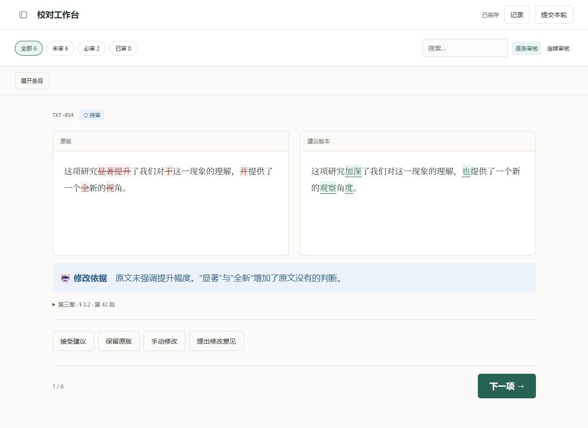
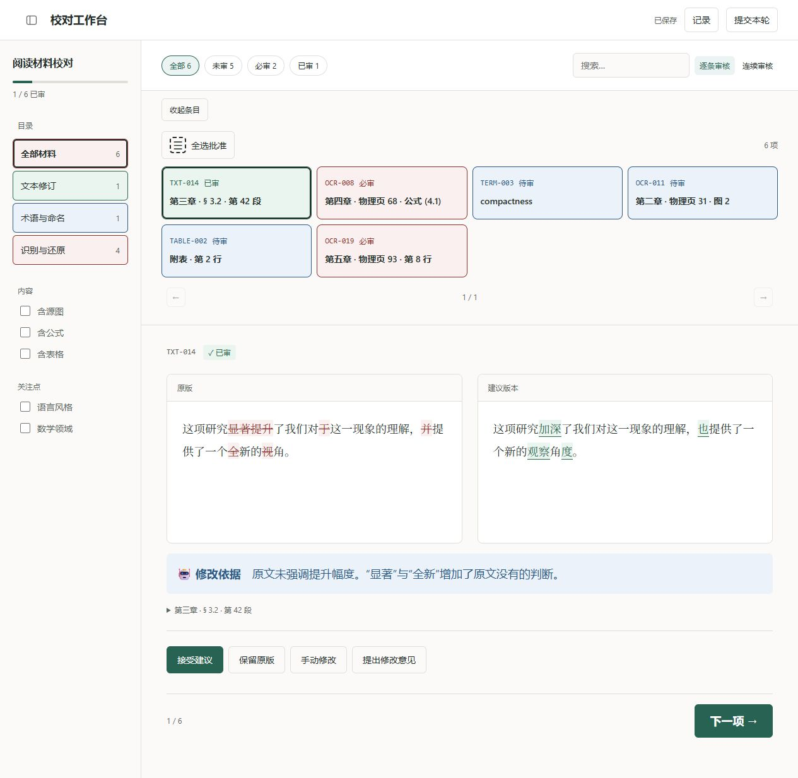

# 校对工作台 · Review Workbench

为其他 skill 提供可复用的人工校对界面。翻译、OCR、写作等工作流可以把需要人判断的内容整理成审核包，让用户在浏览器里对照原版、建议和参考材料，随后读取审核结果继续处理原稿。

支持文字修订、术语、图片、TeX 公式和表格。网页在本机运行，无需账号，也无需构建前端。



## 下载与开始

当前版本：[0.3.0](https://github.com/YanagionSabigi/review-workbench/releases/tag/v0.3.0)。两个 ZIP 面向不同用途：

| 你要做什么 | 下载哪个包 | 怎么开始 |
| --- | --- | --- |
| 为自己的 AI 工作流接入校对能力 | [技能包](https://github.com/YanagionSabigi/review-workbench/releases/download/v0.3.0/review-workbench-skill-0.3.0.zip) | 将解压后的 `review-workbench/` 放入所用工具的 skills 目录，按包内 SKILL.md 接入 |
| 先体验一次人工审核 | [演示审核包](https://github.com/YanagionSabigi/review-workbench/releases/download/v0.3.0/review-workbench-demo-0.3.0.zip) | 完整解压，阅读 `OPEN-ME.txt`，准备好依赖后启动 |

如果别人已经发给你一份审核包，直接使用对方的包即可。Windows 双击 **`开始校对.cmd`**；macOS 可使用 `start_review.command`；Linux 在解压目录运行 `python3 start_review.py`。启动步骤、依赖版本和结果回传方法都写在包内 **`OPEN-ME.txt`**。

收件人需要 Python 3.11+ 和首次安装的 Python 依赖；提交公式决定时还需要 Node.js 18+。**无需 Git 或 AI skill**。启动入口不会自动安装或下载东西，缺少环境时会给出提示。macOS 入口尚未在 macOS 真机运行验证。

## 怎么审核

左上角的侧边栏图标随目录展开、收起切换形状，鼠标悬停会提示当前动作。目录与条目列表默认收起，需要切换材料时点击“展开条目”。

- **逐条审核**：一次专注一项，用放大的“下一项”按钮继续，也可用 ← 返回上一项、→ 或空格进入下一项。编辑文字或打开对话框时保留原有键盘操作。
- **连续审核**：把当前页的材料连续排列，直接向下阅读和处理。
- **筛选与搜索**：按目录、内容类型、关注点和审核状态找到材料。

条目与目录用整块颜色区分状态：蓝色待审、绿色已审、红色必审。展开条目后，左上角的全选图标直接批准本页：有建议时采用建议，无建议时保留原文；必审项、已有人工草稿或已提交的条目会跳过。

每项有四种处理方式，选择后显示相应输入：

| 处理方式 | 你的决定 |
| --- | --- |
| 接受建议 | 采用建议内容 |
| 保留原版 | 保留原版内容 |
| 手动修改 | 编辑文字、TeX 或表格 |
| 提出修改意见 | 留下需要继续处理的意见，也可选中文字后引用 |

右上角“已保存”表示草稿已保存，重新打开后可以继续。完成后点击“提交本轮”，选择这次要交回的条目，再从“记录”下载结果 JSON。上游 skill 或负责修改的人根据提交结果继续处理原稿；尚未提交的草稿不作为最终决定。

多个窗口产生不同草稿时，可以比较“本机版本”和“该文件版本”中的实际内容，再明确选择保留哪份草稿。

<details>
<summary>查看条目与目录的审核状态</summary>

展开条目和侧栏后，整块底色区分蓝色待审、绿色已审和红色必审；左上角全选图标直接处理本页，跳过必审项。



</details>

图片可放大查看；提供整页图时也能打开整页。TeX 编辑会实时预览，渲染范围以 KaTeX 为准。图片圈画尚无操作界面。

## 接入自己的工作流

基本流程是：**准备材料 → 人工审核 → 回传决定 → 继续处理原稿**。

上游 skill 负责整理原版、建议、证据与待审核范围；工作台负责展示、保存草稿和提交记录。审核包可以导出给他人，再导入对方回传的结果。收件人包只包含审核运行所需文件，公式资源按需携带，不夹带 skill、示例源码或 Git 仓库。

- [SKILL 入口](skill/review-workbench/SKILL.md)：调用方式和上游工作流的职责。
- [操作指南](docs/usage.md)：自己的材料、转交他人、回收结果和版本比较。
- [输入与回传协议](skill/review-workbench/references/protocol.md)：数据字段和约束。
- [完整输入示例](examples/demo/package.json)：六条可运行演示材料。

## 先试一下

从源码运行需要 Python 3.11+ 和 Git；提交或导入公式决定还需 Node.js 18+。无需 npm 安装。

```sh
git clone https://github.com/YanagionSabigi/review-workbench.git
cd review-workbench
python -m pip install -r requirements.txt
python -m review_workbench demo --out demo-project
python -m review_workbench serve demo-project/review
```

启动后会自动打开浏览器；未自动打开时，使用终端给出的完整链接。再次继续这份演示，只需运行最后一条命令。

## 参与开发

欢迎通过 [Issues](https://github.com/YanagionSabigi/review-workbench/issues)反馈问题或提交 Pull Request。界面问题请附上操作步骤、浏览器和窗口大小，示例材料尽量使用可公开的内容。

```sh
python -m unittest discover -s tests -t . -v
node --test tests/frontend.test.mjs tests/drafts.test.mjs
```

## 许可与致谢

采用 [MIT 协议](LICENSE)。公式渲染使用 [KaTeX](https://katex.org/)，其[许可证](web/vendor/katex/LICENSE)随资源保留。界面设计参考 [Refactoring UI skill](https://github.com/edisonmbli/refactoring-ui-skill)。
