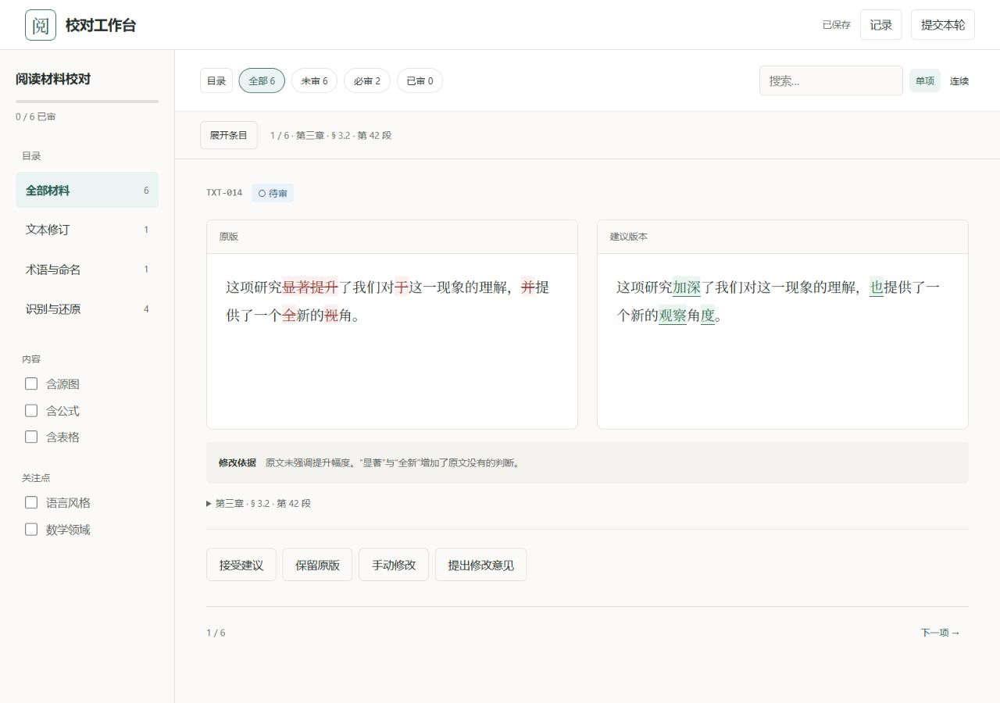

# 校对工作台 · Review Workbench

在浏览器里逐项对照原稿、修改建议和参考材料，留下你的决定，再交回给负责修改的人或 AI。适合译文审校、术语统一、OCR 校正，以及公式、图片和表格的人工核对。



## 先试一下

需要 **Python 3.11+** 和 **Git**。如果要提交或导入公式的审核结果，还需要 **Node.js**。前端资源随项目提供，无需安装 npm 依赖或构建网页。

```sh
git clone https://github.com/YanagionSabigi/review-workbench.git
cd review-workbench
python -m pip install -r requirements.txt
python -m review_workbench demo --out demo-project
python -m review_workbench serve demo-project/review
```

启动后会自动打开本机网页。演示包含六条材料，可以试着改一段文字、核对公式或给表格留意见。再次打开演示时，运行最后一条命令即可；之前保存的内容会保留。若网页没有自动打开，使用终端给出的完整链接。

## 怎么校对

用目录和筛选找到材料，点击“展开条目”切换审核对象。“逐条审核”一次看一项，也可以切到“连续审核”；目录和条目列表默认收起，给正文留出空间。

每一项可以选择一种处理方式：

| 处理方式 | 用途 |
| --- | --- |
| 接受建议 | 采用右侧的建议内容 |
| 保留原版 | 采用左侧的原版内容 |
| 手动修改 | 直接编辑文字、TeX 或表格 |
| 提出修改意见 | 留下需要继续处理的意见；选中文字后也可以引用 |

右上角“已保存”表示草稿已经保存。完成后点击“提交本轮”，选定要交回的条目。提出意见后，仍需由负责修改的人或 AI 处理；工作台保存审核结果，原稿的写回由原工作流程完成。

图片可放大查看，提供整页图时也能打开整页；TeX 编辑会实时预览。公式预览使用 KaTeX，可用命令范围与完整 LaTeX 有区别。图片圈画尚无操作界面。

## 用自己的材料，或交给别人校对

工作台接收一个审核包，里面包含原版、建议和参考材料。准备工作通常交给 AI skill，也可以照示例手动整理。

- **使用自己的材料**：[操作指南](docs/usage.md)介绍准备、启动和继续一轮审核的方法。
- **转交他人**：可以导出精简 ZIP；对方无需 Git 或 AI skill，解压后在本机校对，再把结果交回。具体步骤见[转交与回收](docs/usage.md#转交与回收)。
- **接入 AI 工作流**：从 [review-workbench skill](skill/review-workbench/SKILL.md)开始；输入格式见[协议](skill/review-workbench/references/protocol.md)和[完整示例](examples/demo/package.json)。

网页和审核数据由本机服务提供，使用时无需登录。多人或多个窗口给出不同决定时，工作台会保留冲突，供你明确选择。草稿比较中的“本机版本”指当前会话的修改，“该文件版本”指审核文件里已经保存的内容。

## 参与开发

欢迎通过 [Issues](https://github.com/YanagionSabigi/review-workbench/issues)反馈问题或提交 Pull Request。报告界面问题时，附上操作步骤、浏览器和窗口大小会更方便复现；示例材料请尽量使用可公开的内容。

在仓库目录运行测试：

```sh
python -m unittest discover -s tests -t . -v
node --test tests/frontend.test.mjs tests/drafts.test.mjs
```

## 许可与致谢

项目采用 [MIT 协议](LICENSE)。公式渲染使用 [KaTeX](https://katex.org/)，其许可证随[内置资源](web/vendor/katex/LICENSE)保留。界面设计参考 [Refactoring UI skill](https://github.com/edisonmbli/refactoring-ui-skill)。
