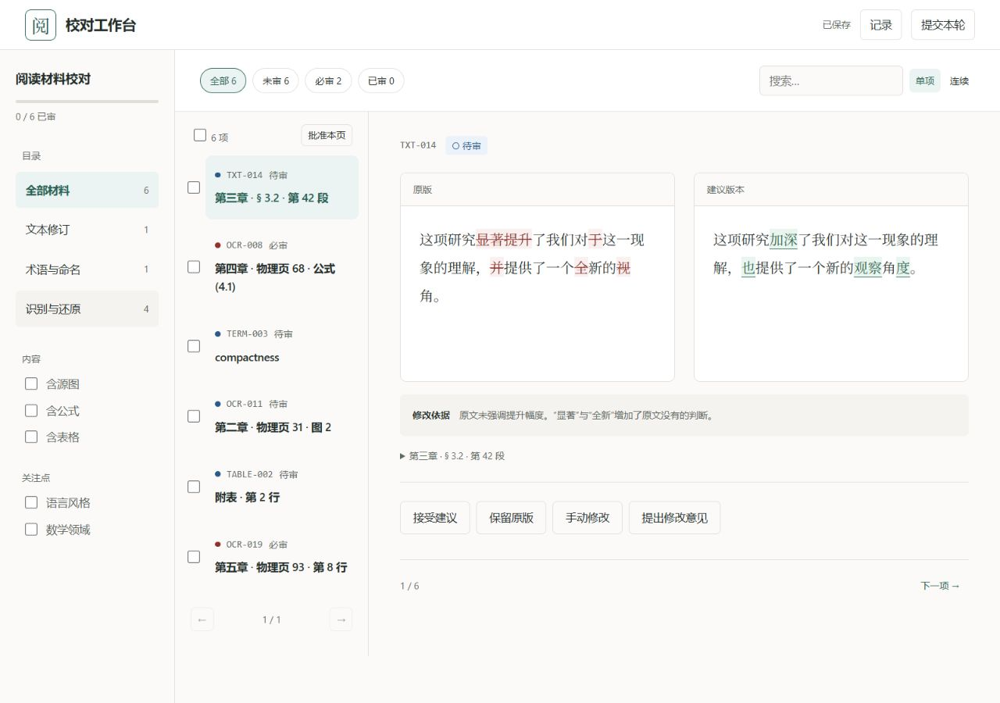
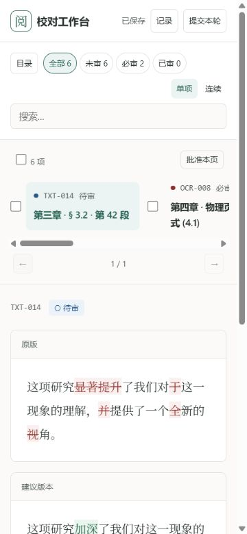
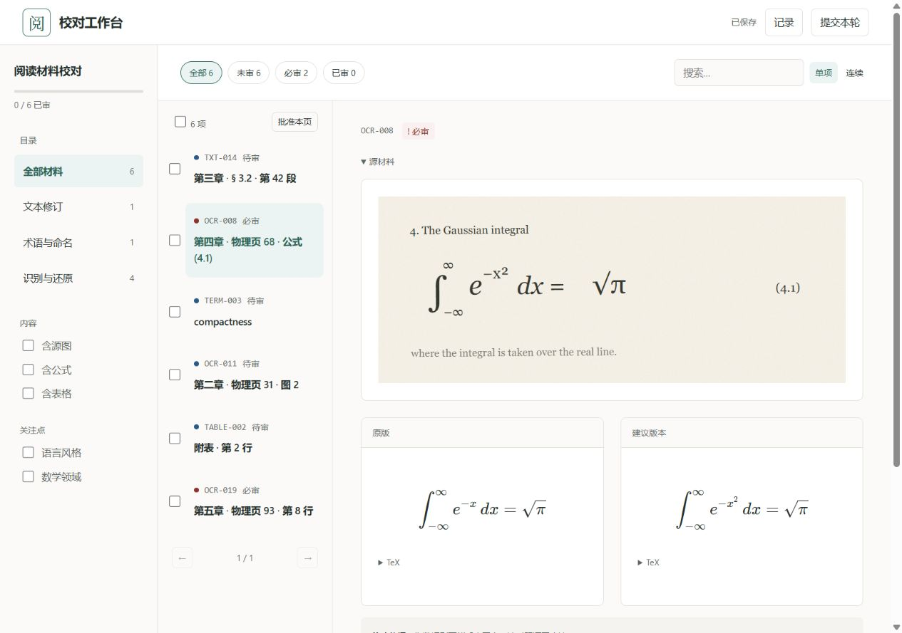
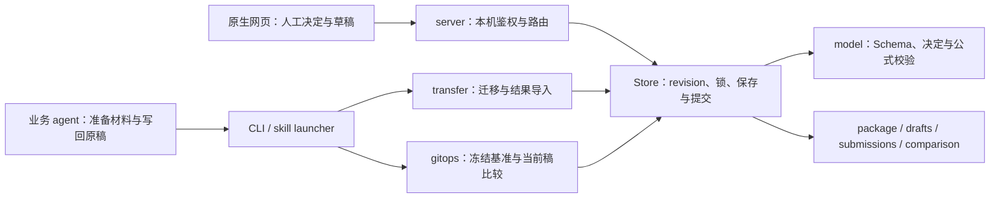

# 校对工作流架构与界面诊断

日期：2026-10-30。审阅基线：`7835f8a`，分支 `feat/review-workbench`。

结论：轻量本地工具的技术方向与使用场景匹配。界面已经有清楚的编辑工作台气质：暖白纸面、深绿色强调、衬线正文和克制的差异标记。优先改善阅读空间分配、异常恢复界面和状态管理的集中程度。当前证据不支持引入前端框架或数据库作为第一步。

## 方法与证据范围

使用 `superpowers:using-superpowers` 组织技能选择，使用新安装的 `refactoring-ui` Workflow D，按层级 → 布局 → 排版 → 色彩 → 深度 → 图片 → 收尾顺序审阅；架构分析采用 `codebase-design` 的模块深度、接口和变更局部性原则。本轮是诊断，交付报告、截图和配色检查输入；没有修改运行代码。

框架检测：原生 HTML / ES modules，Python 标准库 HTTP；无 Tailwind、无组件库、已有 `web/styles/tokens.css`；明确 `color-scheme: light`，未见暗色模式实现。现有色彩、字体和无构建运行方式优先于技能示例。

实际运行本轮新建的六项演示包。浏览器视口分别设置为 **1280×900** 和 **375×812**；保存的截图文件实际像素为桌面 1280×900、窄屏 360×779、公式 1265×889（浏览器截图输出与视口设置不同）。公式页出现垂直滚动条，布局可用宽度相应减少。检查了目录展开、文本编辑与自动保存、刷新恢复、切至空意见、公式与完整源图、无搜索结果恢复入口。未把演示操作应用到业务材料。

架构风险均来自代码检查，另行标明未做故障注入或并发复现；测试通过不等于排除这些风险。没有报告本轮未验证的跨平台可用性。

## 架构图与已有优势

该图表示主要调用关系；另有 `storage` 在提交时动态调用 `transfer.history_conflicts` 的反向依赖，见 A3。

- 人工决定与业务原稿分离，工具不代替 agent 写回；审核基准采用独立 Git ref 与临时 index，保护现有 HEAD 和暂存内容。
- `Store` 已提供有深度的接口：调用者无需自行实现文件锁、revision 比较、材料冻结检查和单文件原子替换。
- 提交保留不可变历史，冲突解决生成新记录；导入重算决定而非盲信 accept 内容。
- HTTP 限制 loopback、Host、会话 token 与写入 Origin；前端通过 sessionStorage 保存会话并从地址栏移除 key。它适合可信本机使用，不能据此推断可直接对外部署。
- 图片完整显示、公式本机渲染、无 npm 构建，符合当前文献校对任务的可迁移性需求。

## 架构发现

这里的 P1 表示应优先处理的正确性风险，P2 表示维护性或扩展成本；不与下文视觉一致性严重度混用。

| # | 级别 | 位置 | 现状与失败场景 | 建议与验证方式 |
| --- | --- | --- | --- | --- |
| A1 | P1，静态风险 | `review_workbench/storage.py:148`、`:166`；`transfer.py:122` | 提交、解决冲突和导入分多次写 submissions、drafts、comparison。锁能防止正常并发交错，单文件替换也安全，但进程在两个替换之间退出时，历史可能已落盘而 revision 或比较视图尚未更新。启动时未见针对这类中途退出的完整恢复步骤。 | 先明确 submissions 为权威记录、comparison 为可重建派生数据；增加启动对账或操作日志。用故障注入在每个写入点后终止，再验证重启后的 revision、决定与冲突一致性。不能把文件锁当作跨文件事务。 |
| A2 | P1，静态风险 | `review_workbench/gitops.py:125`、`:137`、`:168` | compare 在读取历史、计算结果后才获取写锁。若计算期间有新的提交/导入/解决，旧计算可能最后写入 comparison，覆盖较新的冲突视图。读历史与最终发布之间没有版本校验。 | 在锁内捕获历史快照与版本，计算后再次校验，版本变化时重算或拒绝发布。以确定性并发测试控制“读历史 → 新提交 → 发布旧结果”的顺序；本轮未复现该竞态。 |
| A3 | P2 | `web/scripts/app.js:60`、`:599`、`:741`；`storage.py:162`；`transfer.py:107` | 1268 行 app.js 同时维护有效决定、筛选、渲染、保存并发、弹窗、历史与图片交互。前端 effective 与后端 resolve_decision 各自表达有效性规则。storage 又动态调用依赖 storage 的 transfer，冲突投影的职责归属不集中。 | 优先沿真实变更点提取审核会话状态与保存协调模块，纯有效性/筛选函数用相同 JSON 场景做前后端契约测试；把纯冲突投影集中到 history 模块，使存储和迁移共同调用。保持原生前端；不按每个 DOM 控件拆文件。 |
| A4 | P2 | `tests/frontend.test.mjs`、`tests/drafts.test.mjs` | 5 项 Node 测试覆盖 diff、备份版本和对象键，但不执行 app.js 的 DOM / 保存 / 弹窗流程。手动验证已有记录，复杂状态调整后仍需反复人工回归。 | 为最关键的真实用户链路保留少量浏览器回归：编辑后刷新、空意见不计完成、保存 409 的明确选择、部分提交。用于验证行为，不为每个样式写测试。 |

## 界面发现

本轮已检查画面及主要文字配色中，未发现 P0 的不可读或无法操作问题。下表的视觉 P1 指一致性或阅读体验受影响，P2 指收尾与维护性；不是宣称所有异常状态均通过视觉验证。

| # | Lens | Severity | Location | Rule | Now | Proposed | Effort |
| --- | --- | --- | --- | --- | --- | --- | --- |
| U1 | hierarchy | P1 | 顶部 `#submit`，`web/index.html:27` | §2.8 | “提交本轮”与“记录”同为普通描边按钮。桌面和窄屏都缺少明确的最终动作层级。四种决定的填色表达互斥选择，属于既有约定，应保留。 | 提升“提交本轮”的动作层级；没有可提交决定时明确不可用。通过按钮自身的样式与状态表达，不增加解释横幅。 | S |
| U2 | layout / typography | P1 | 桌面 `.shell` / `.review-layout` / `.text-source`，`app.css:147`、`:258`、`:394` | §2.1、§3.3、§4.3.1 | 1280px 下目录 224px、队列 248px 常驻；测得每个正文块仅 295px，18px 中文一行约 16 字。导航用了较多横向空间，长段落会产生大量折行。当前短演示尚能读，长文持续阅读成本更高。 | 保留当前默认，提供折叠队列/目录的阅读空间；或依据正文最小宽度提前切换对照布局。用真实长中文段落验证，不把英文 45–75 字符机械套到汉字。 | M |
| U3 | layout | P1 | 375px 初始态及目录展开态，`app.css:751` | §3.3.1、§3.5 | 队列变成横向卡片，仍含批量区和分页，占据约 200px 以上高度；初始首屏原版内容接近底部，建议与决定在下方。展开目录后，目录内容又把正文继续向下推。功能可达，不是缺少移动入口。 | 窄屏把队列收成当前条目/序号与展开入口，按需展开列表；保留目录与交叉筛选。验收“375px 下从当前材料进入意见输入”的滚动与点击成本。 | M |
| U4 | hierarchy / typography | P1，code-only | 草稿版本差异弹窗，`app.js:166` | §2.5.4、§4.3.1 | 两边直接打印完整 drafts.items JSON，让人从 block id、mode 等结构中寻找实际文字变化。尚未在本轮制造双页冲突，判断来自渲染代码。 | 按条目定位、处理方式和实际文本/表格变化呈现；技术 JSON 留在按需展开的详情。先保留现有两种明确选择的语义，再讨论是否需要逐条合并。 | M |
| U5 | finishing | P2 | 搜索无匹配结果，`app.js:347`、`:741` | §8.4 | 空状态有“查看全部”，恢复入口有效；但 0 项时仍保留“批准本页”、全选和 1/1 分页，操作区没有随结果数量收敛。已在真实页面确认。 | 0 项时隐藏无意义的队列操作与分页，保留筛选和恢复入口。 | S |
| U6 | layout / typography / depth | P2，code-only | `tokens.css:20`、`app.css` | §1.5、§3.2、§4.1、§6.2.1 | 已定义间距、字号和 radius token，但大量规则直接写 12/16/24/32px 等字面值；数值本身大多在现有尺度内。修改尺度时仍要逐处查找；阴影也按局部规则定义。 | 逐步让重复的语义尺寸引用已有 token，并为确有复用的圆角/阴影命名。不为凑色阶或阴影层级新增当前不用的样式。 | S |

## 应保留的视觉决定

- UI 使用无衬线字体，正文使用衬线字体，材料与操作区容易区分；无须另换品牌配色或增加装饰性插图。
- 决定按钮初始不选中、四模式互斥、输入按模式展开，符合已记录的项目约定。实际验证手动编辑保存后刷新内容恢复，切至空意见后已审计数回到 0。
- 源图使用 contain 完整呈现；公式例子的上下文与建议均可见。文献证据完整性优先于装饰图片的裁切建议。
- 选中态、待审/必审/已审、diff 均有文字或形状辅助，不只依赖颜色。键盘 focus-visible 样式已存在。
- 边框、暖白底与分组间距足以区分层次。没有证据支持通过更多阴影提高质量。

主要配色按现有 HSL tokens 转换为 8 位 RGB，用技能自带 `check_contrast.py` 检查。输入保存在 [contrast-pairs.json](contrast-pairs.json)，10/10 达到普通文字 4.5:1：正文/纸面 13.44、辅助/纸面 5.54、强调/浅底 6.34、白字/强调底 7.10、三种状态标签 5.82–7.05。换算存在四舍五入；没有据此宣称所有控件边界、禁用态或所有状态均符合无障碍标准。

## 建议顺序与验收

1. 先建立 A1/A2 的故障与并发验证，再实现一致性恢复；保护审核结果的可信度。
2. 优先处理 U2/U3 的空间分配，用长中文、长公式、表格三种材料在 1280/375 验收；比较稿与决定区应易于到达。
3. 处理 U1/U4/U5 的最终动作、冲突恢复与空态，沿用已有简洁文案约定。
4. 随上述功能变更处理 A3/A4 和 U6，把状态规则及测试集中到稳定接口，避免纯粹按行数拆分。

这些是下一轮可评审的改进建议，不表示已经实现。本轮没有重构、迁移依赖或改写业务稿。

## 安装记录与验证

- 来源：[edisonmbli/refactoring-ui-skill](https://github.com/edisonmbli/refactoring-ui-skill)，技能子目录 `skills/refactoring-ui`，实际调用名 `refactoring-ui`。
- Codex：安装于 `C:/Users/10166/.codex/skills/refactoring-ui`，使用官方 skill-installer 脚本下载。本轮显式读取新技能后执行诊断；下一回合可正常发现。
- CC Switch：安装于 `C:/Users/10166/.cc-switch/skills/refactoring-ui`，登记其现有 SQLite skills 表与 skill_repos 表，启用 Codex。没有擅自启用其他客户端。两份目录的 26 个文件逐一 SHA256 相同。
- CC Switch 数据库改动前，使用 SQLite backup 创建 `C:/Users/10166/.cc-switch/backups/before-refactoring-ui-1793340281.db`。登记后只读核验 directory 与 enabled_codex。未实测 CC Switch 远程更新检查，也未在本轮核验其界面刷新。
- CC Switch 的中心目录/每客户端同步方式依据[官方技能说明](https://github.com/farion1231/cc-switch/blob/main/docs/user-manual/en/3-extensions/3.3-skills.md)，实际表结构以本机数据库为准。Codex 技能机制参见[官方说明](https://learn.chatgpt.com/docs/build-skills)。
- `python -m unittest discover -s tests -t . -q`：27 项通过，44.745 秒。首次沙箱运行有四项 loopback 请求被系统禁止；在允许本机连接的环境重跑全部通过，未据此修改产品代码。
- `node --test tests/frontend.test.mjs tests/drafts.test.mjs`：5 项通过。
- `check_contrast.py --matrix docs/audits/2026-10-30/contrast-pairs.json`：10/10 通过。

全局技能安装和 CC Switch 数据库不属于本仓库 Git；Git 仅记录本报告、审阅截图与配色检查输入。演示包保留在忽略目录 `artifacts/audit-demo-20261030`，不是交付业务数据。
