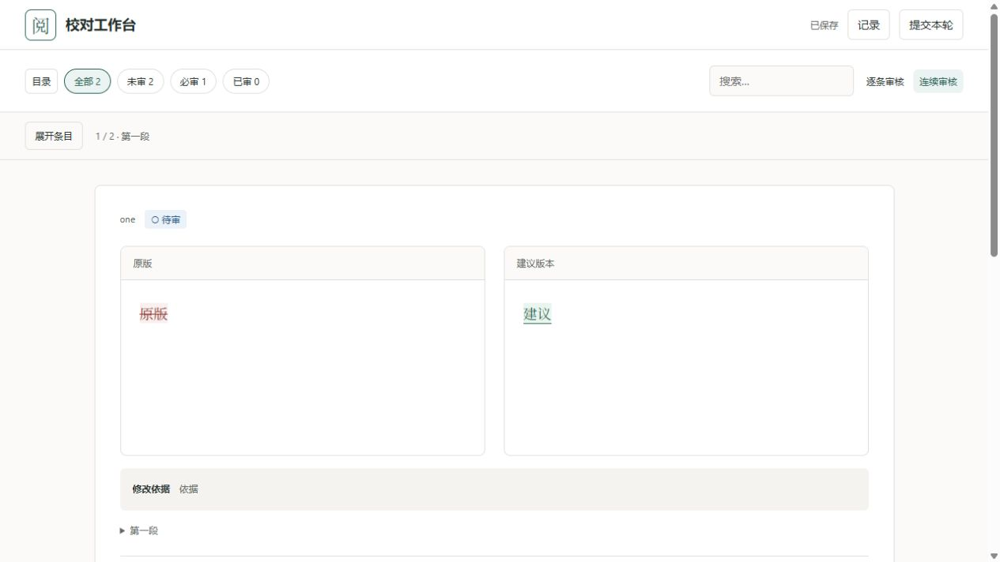

# 审核模式与收件人包精简验证

用户要求连续审核删除无效的“下一项”，视图名称改为“逐条审核 / 连续审核”，目录默认关闭，并精简交给他人的审核包。

## 实施

- 连续审核不生成下一项按钮；逐条审核保留其切换功能。目录初始化为关闭，窗口变大时也不自动打开。
- 将收件人审核包与 `export-skill` 安装包分开复制。收件人包不再包含 skill、示例、Git 仓库、demo 和完整 CLI 入口；`export-skill` 仍提供安装所需资源。
- 网页、JSON 数据、少量 Python 服务模块、校验 schema、依赖说明及许可证保留。基准使用 `baseline.json` 的材料指纹和原 base_commit 核对，接收者无需 Git；原提供者仍以业务 Git 为基准，旧 Git 迁移包仍兼容。
- 没有 TeX 的材料不携带 KaTeX 及其校验脚本，也移除 HTML 中相应引用；含 TeX 时保留离线渲染、字体和上游许可证。
- `start_review.py` 直接启动本机服务，不再经过完整 CLI；启动时不执行安装或下载。依赖手动安装步骤、Python/Node 版本要求、回传方式写在 OPEN-ME.txt。wheels 仍仅在显式 `--offline-deps` 时加入。

## 复现与自动检查

原导出迁移测试新增“不含 skill”断言后先失败，再修改打包逻辑。新增材料篡改拒绝与公式资源保留测试。

- Python 全量：35 项通过，112.766 秒。
- Node：7 项通过；app.js 语法、Python compileall、Git diff 检查通过。
- 真实解包后，以空 PATH 启动子进程，证明普通文本包启动不调用 Git/Node；保留依赖已安装的 Python 环境。
- 迁移、审核提交、导出结果再导回原包的回归通过；被改动的材料不能通过基准校验。
- 独立只读审阅未发现可操作问题，确认必要 import 链、离线公式依赖和旧迁移包兼容分支保留。

## 运行测量

本机 Windows / Python 3.14，小型演示，Python 依赖已安装：

| 项目 | 结果 |
| --- | --- |
| 原实现服务 import | 1.909 秒 |
| 原实现小演示 server 初始化 | 0.803 秒 |
| 新导出两条纯文本包 | 44,712 字节，25 个文件 |
| 新包从启动子进程到输出服务 URL | 2.413 秒 |
| 含公式的六项演示包 | 1,014,593 字节 |

这些是本机样例测量，不是所有材料的耗时保证。没有拿到用户报告耗时数分钟的那份实际包，无法确认其瓶颈；大图片、文件同步/存储、首次依赖安装等仍需针对具体环境测量。没有把未知原因归结成已修复的单一故障。

## 真实网页

从新导出 ZIP 的实际解包目录启动服务：目录 aria-expanded=false；连续审核两张卡片、下一项按钮数量 0；切到逐条审核后下一项可以切到第二段。保存、提交成功，并显示“下载结果”入口。无公式包不加载 KaTeX。

新的导出规则只适用于更新后重新生成的包，已有 ZIP 不会自动改变。回传结果使用网页“记录”下载 JSON，精简包不提供完整开发 CLI。
