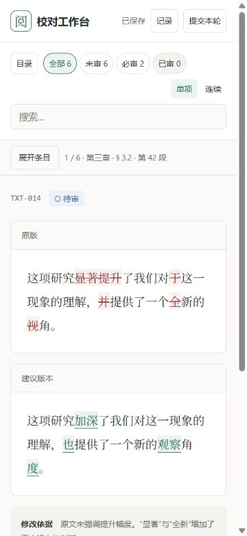
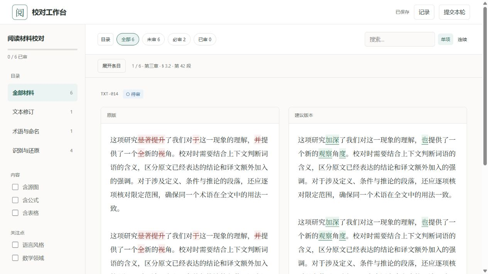
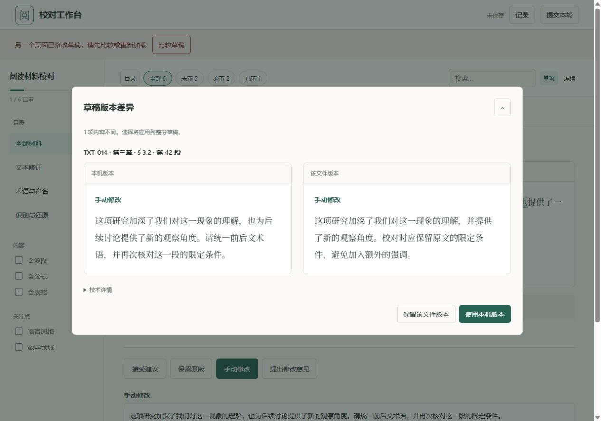
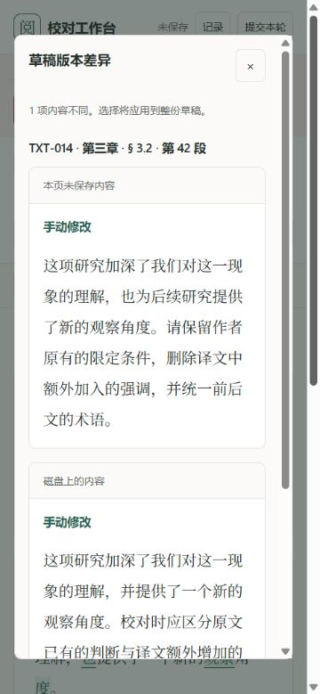

# 阅读空间与草稿比较改进

本轮落实原诊断 U2、U3、U4。运行代码基线 `3acd9b9`；现有配色、原生前端、四模式互斥和保存协议保持一致。README 未新增或改写。

## 已实施

| 原问题 | 实施 | Refactoring UI 依据 |
| --- | --- | --- |
| 桌面目录、队列和正文三栏常驻，正文被挤压 | 条目队列改为紧凑概要栏，按需展开；目录也可收起。选择条目后列表收回，焦点回到展开按钮 | §2.1、§3.3 |
| 窄屏横向队列和分页占据大量首屏空间 | 目录和条目默认折叠，队列概要约 52px 高；保留目录、交叉筛选、多选、批量和分页能力，展开后纵向选择 | §3.3.1、§3.5 |
| 草稿冲突比较直接展示 JSON | 只列内容不同的条目，以定位、处理方式、实际文字/表格/公式/图片、意见和引用展示双版本；未激活输入收进其他草稿，JSON 收进技术详情 | §2.5.4、§4.3.1 |

版本选择仍针对整份草稿。弹窗明确提示这一点，没有暗中改成逐条合并。对象字段顺序和空默认字段不再制造虚假的内容差异；编辑文字的空字符串不会被替换成建议文本。

## 真实浏览器验证

浏览器视口设置为 1280×900 和 375×812。截图输出可能扣除滚动条或缩放，与设置视口的像素不同；原始文件保存在本目录。

- 同一短文本在 1280px 下，正文每栏从原审阅测得的 295px 增至 426px，约增加 44%；收起目录后为 458px。长文出现滚动条时约 419px。
- 窄屏初始态同时可见原版和建议，不再先经过约 200px 的横向条目卡片。默认队列高度实测 52.4px。
- 目录展开后主目录与交叉筛选仍可达；展开条目、选择公式项后，`aria-expanded` 回到 false。连续视图也可展开全部六项并操作列表。
- 制造两个真实页面的过时 revision：一页保存长文本，另一页编辑不同版本并触发保存 409。弹窗实际显示两个文本版本，技术 JSON 初始不可见。
- 点击“使用本页版本”后，等待已保存并刷新，文字保持；另一页再次触发冲突并点击“保留磁盘版本”，恢复到相同文字。
- 另向真实演示包保存公式和表格草稿；比较弹窗实际产生一个 KaTeX 公式和一张表格，并正确列出三个变化条目。
- 另建含长中文段落的冻结审核包，验证正文不横向溢出；375px 下可定位意见输入、填写并保存。

## 自动验证与审阅

- 测试先行：草稿差异/内容投影测试在旧代码上因缺少能力而失败；许可证导出测试在未复制 LICENSE 的实现上失败，再分别补齐实现。
- `node --test tests/frontend.test.mjs tests/drafts.test.mjs`：7 项通过，覆盖空默认值、字段顺序、对象原型同名 ID、所选版本、空文字、TeX、表格、图片保留与不修改材料。
- `python -m unittest discover -s tests -t . -q`：33 项通过，64.941 秒，包含上一轮 19 次强制退出恢复场景；导出 ZIP 实测带 LICENSE。
- `node --check web/scripts/app.js`、Python compileall、`git diff --check`：通过。
- 独立只读代码审阅未发现阻断问题；审阅者另跑草稿测试 5 项通过，浏览器验证由主会话执行。

## 开源准备

增加 MIT LICENSE，版权归属 2026 YanagionSabigi；保留 KaTeX 自带许可证。运行代码导出时携带 MIT 文件。未生成新的 README，也未使用 GitHub 的初始化 README 功能。

演示材料、服务 token 和运行草稿位于忽略的 artifacts 目录，未进入本轮 Git 提交。本轮 GitHub 目标使用用户纠正后的 `YanagionSabigi/review-workbench`。

已创建并核验[公共远程仓库](https://github.com/YanagionSabigi/review-workbench)，默认分支 main，GitHub 识别许可证为 MIT。实现提交 `4164773` 已推送；本地 origin 指向该仓库。现有 README 保留原内容。
